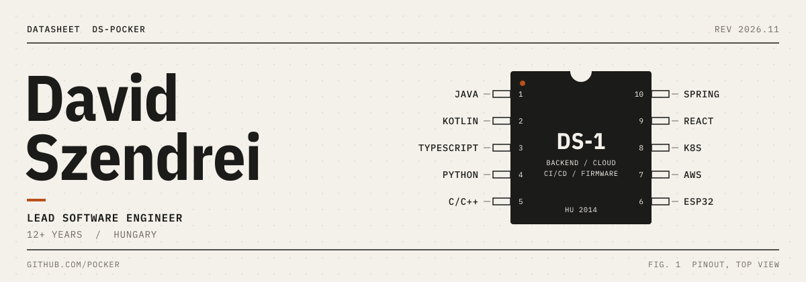
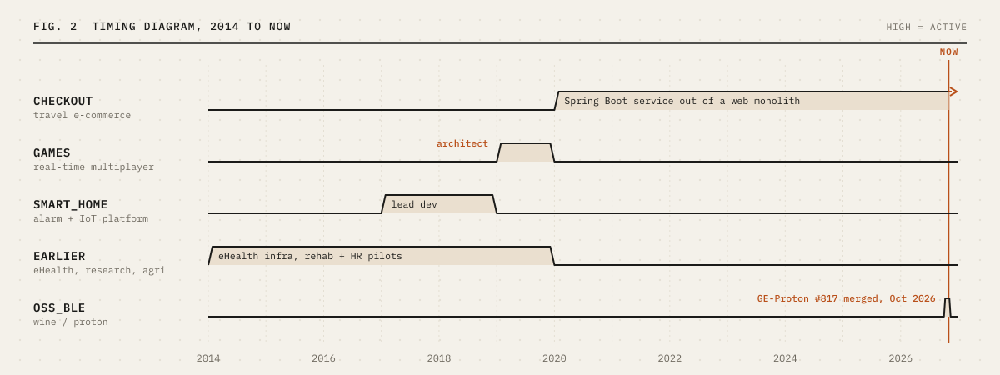

<picture>
  <source media="(prefers-color-scheme: dark)" srcset="assets/header-dark.svg">
  
</picture>

Backend, cloud and CI/CD engineer with a habit of going down to the firmware and driver level when a problem calls for it.

## About

I have built software for healthcare research, national eHealth infrastructure, IoT and smart home platforms, a real-time multiplayer games platform, and large-scale e-commerce checkout. Today I work as a hands-on, chief-engineer style engineer on a checkout platform: I build proofs of concept, evaluate new technologies, help with technical planning and lead smaller workstreams end to end.

- Two monolith-to-microservice migrations: contributor on the first, key engineer from first spike to production on the second.
- Owned CI/CD, cloud deployment and production readiness for a high-traffic service.
- Contributed Bluetooth LE support to Wine/Proton. It is merged upstream and shipped in GE-Proton.
- Build AI-assisted development workflows with Claude Code: multi-agent pipelines that plan, implement, review and test changes, plus agent context and skills for large codebases.

## Experience

<picture>
  <source media="(prefers-color-scheme: dark)" srcset="assets/timing-dark.svg">
  
</picture>

**Large-scale e-commerce checkout platform** · *2020 – present* · Lead Software Engineer
Hands-on, chief-engineer style role (Lead grade) on a checkout platform serving multiple brands, product lines and markets. Mostly architecture, proofs of concept and code; I lead smaller workstreams and mentor the team.
- Spiked and drove the extraction of checkout from a legacy web monolith into a standalone Java/Kotlin Spring Boot service, from the first spike to production traffic, then retired the monolith bridge in a clean cut-over (−66k lines)
- Built reachability and bean-graph tooling that safely removed 1,442 dead classes (191k lines), each batch verified by build, boot, smoke tests and a bean-graph diff
- Delivery workstream: lab/prod pipeline split, release-gated production deploys, canary rollouts, and a Kubernetes environment with Cypress end-to-end tests for every PR
- Met three hard platform deadlines without an outage: OpenTelemetry tracing, keyless CI with GitHub OIDC, artifact registry migration
- Production on-call: incident triage and data-driven rollout decisions during traffic migrations
- Redesigned startup and health probes after profiling ~1,200 Spring beans at boot; cut lab and prod infrastructure cost
- Evaluated new approaches (merge queues, traffic-mirroring parity tests, AI coding agents) and fed the results into planning
- Enabled other teams with deploy-and-test guides, canary support and automated release announcements; proposed retiring a duplicate stack behind a traffic-mirroring parity test
- AI-assisted engineering: agent context, rules and skills so coding agents work safely in a very large codebase

*Java 21 · Kotlin · Spring Boot · Kubernetes · GitHub Actions · Spinnaker · Cypress · AWS · OpenTelemetry · Datadog*

**Real-time multiplayer games framework** · *2019 – 2020* · Architect & lead developer
Designed a greenfield framework for web-based multiplayer games on top of an automatic scoring hardware system. I chose the stack, defined the coding standards, led the team and acted as Scrum Master.
*NestJS · React · React Native · Socket.io · TypeScript*

**Smart home and alarm platform** · *2017 – 2019* · Lead developer
Moved device-to-server communication from raw sockets to AWS IoT with a certificate per device. Added Z-Wave support, rule-based automations, WebSocket messaging, a cross-platform mobile app and IP camera streaming. Contributed to the migration from the monolith to microservices.
*Spring Boot · Python · AWS IoT / Lambda / SNS · Ionic · PostgreSQL*

**Earlier** · *2014 – 2020*
Greenhouse monitoring tools, national eHealth infrastructure (Liferay, WildFly, SOAP, SAML), and university healthcare research pilots: stroke rehabilitation, heart-rate monitoring and a portable plethysmograph (Android NDK, C++).

## Open source

- **[GE-Proton #817](https://github.com/GloriousEggroll/proton-ge-custom/pull/817)** (merged): opt-in Bluetooth LE support in Wine/Proton. Zwift and Rouvy can now pair directly with smart trainers on Linux.
- **[BikeControl #424](https://github.com/OpenBikeControl/bikecontrol/pull/424)**: Linux desktop support for the open-source controller and virtual-shifting app (Flutter).
- **[pocker/wine](https://github.com/pocker/wine)**: Wine fork with the BLE implementation (`winebth.sys`, `bluetoothapis`, WinRT `Windows.Devices.Bluetooth`).

## Projects

- **Grupetto**: organise group rides and runs with your club, including events, live tracking, routes and race results. Built with a full agentic workflow: Claude Code multi-agent pipelines that plan, implement, review and test each change. *Launching soon.* 
  Python · React · React Native · Claude Code
- **[fsi6-joystick](https://github.com/pocker/fsi6-joystick)**: turns a FlySky iBUS/SBUS receiver into a Linux joystick for FPV simulators. 
  Python · uinput
- **Hardware and firmware**: a BLE power-driven fan controller, an ESP-NOW floor heating controller with Home Assistant integration, a 3D printer multi-material unit with a [Klipper plugin](https://github.com/pocker/chamois-klipper), and a [custom relay board](https://github.com/pocker/oli-relay-controller). 
  ESP32 · C++ · PlatformIO · ESPHome · PCB design

## Toolbox

| | |
|---|---|
| **Languages** | Java · Kotlin · TypeScript / JavaScript · Python · C / C++ |
| **Backend** | Spring Boot · Node.js / NestJS · FastAPI · gRPC · GraphQL · REST |
| **Frontend & mobile** | React · React Native · Ionic |
| **Cloud & DevOps** | AWS · Docker · Kubernetes · Helm · GitHub Actions · Spinnaker · Jenkins |
| **Observability** | OpenTelemetry · Datadog · Splunk · Grafana |
| **Testing** | JUnit 5 · TestNG · Mockito · Cypress · Jest · Vitest · pytest |
| **Data** | PostgreSQL · MongoDB · Redis · Elasticsearch |
| **AI engineering** | Claude Code · GitHub Copilot · multi-agent workflows · agent context, rules & skills · MCP |
| **Embedded** | ESP32 · PlatformIO · ESPHome · BLE · MQTT · Z-Wave |
